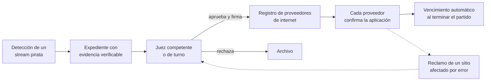

# Desafío Fútbol: plataforma federal de órdenes de bloqueo en vivo

*Consigna original publicada por la organización (qualydata-org/desafio-futbol), reproducida sin cambios.*

> **Aviso.** Todos los datos de este repositorio son ficticios: proveedores de internet, juzgados, jueces, partidos, dominios e IPs. Los dominios terminan en `.test` o `.example`, las IPs son de documentación (RFC 5737) y los ASN son del rango privado. No se bloquea nada real: todo ocurre dentro del simulador. Este material no es asesoramiento legal.

---

## Contexto

Un partido dura dos horas. Un sitio pirata cambia de dominio o de servidor en minutos. Para bloquearlo a tiempo hace falta que, mientras se juega, un juez pueda revisar evidencia confiable y que la orden llegue a todos los proveedores de internet, y no solo a los grandes.

### Argentina hoy

- **Mayo de 2025.** Primer bloqueo en vivo. Lo impulsó la Unidad Fiscal Especializada en Ciberdelitos (UFEIC) de San Isidro y lo ordenó el Juzgado de Garantías N.º 4 de San Isidro.
  - El bloqueo por IP rigió solo durante los partidos; el bloqueo por DNS quedó permanente.
  - La orden llegó a los proveedores a través de sus cámaras (CABASE y CAPPI), porque ENACOM no tenía un registro actualizado de todos los proveedores.
- **1 de noviembre de 2026 (Superclásico).** A partir de una presentación de ALIANZA, la UFEIC pidió a ENACOM el bloqueo de 182 dominios, con un mecanismo dinámico que actualiza la restricción cuando los sitios cambian de dominio.
- **Objeciones de CABASE:**
  - Los proveedores chicos no pueden reaccionar en tiempo real.
  - No hay reglas claras sobre costos, duración del bloqueo ni seguimiento.
  - Bloquear una IP compartida puede tirar abajo servicios legítimos.

El mecanismo existe, pero depende de una sola fiscalía y un solo juzgado, sin un procedimiento formal ni un canal estándar hacia todos los proveedores.

### Otros países

| País | Modelo | ¿Interviene un juez? |
|---|---|---|
| Italia (Piracy Shield) | Plataforma del regulador; los proveedores bloquean en 30 minutos. Tuvo bloqueos de sitios legítimos. | No |
| Francia | El juez dicta la orden y el regulador (ARCOM) actualiza la lista. | Sí, la orden inicial |
| Reino Unido | La High Court dicta órdenes en vivo; la lista se actualiza durante los partidos. | Sí, la orden inicial |
| Grecia | Comisión administrativa con procedimiento especial para eventos en vivo. | No |
| Perú y México | Bloqueos administrativos masivos (Indecopi, IMPI). | No |

No encontramos ningún país donde cada pedido llegue en el momento a un juez de turno a través de una plataforma. Eso es lo que les proponemos construir.

## El desafío

Construir el **MVP de una plataforma federal de órdenes de bloqueo en vivo** que haga el circuito completo durante un partido:



### Qué tiene que hacer la plataforma

1. **Armar el expediente** de cada stream pirata, con evidencia verificable:
   - Prueba de que es la señal oficial: la marca de agua extraída coincide con el partido y no corresponde a un licenciatario autorizado en su propio dominio.
   - El servidor que entrega el video (host e IP) y su proveedor (ASN). Bloquear la página que muestra el reproductor no corta el video.
   - Riesgo colateral: qué otros sitios comparten esa IP. Si es una CDN o un hosting compartido, la plataforma recomienda bloquear el dominio en vez de la IP.
   - Hashes de la captura y sellos de tiempo, para que cualquier alteración posterior se detecte.
   - Dónde se promocionó el enlace (X, Discord, Telegram). *(Extra.)*
   - Vencimiento propuesto.
2. **Notificar al juez** competente o de turno, mostrarle el expediente de forma clara y registrar su decisión con firma. El juez entra a la plataforma con su propio usuario y firma solo mientras está de turno. Al cambio de turno, lo pendiente pasa al juez entrante.
3. **Enviar la orden** a cada proveedor del registro, en el tipo de bloqueo que ese proveedor acepta, y **seguir su confirmación**. Si un proveedor falla, reintentar.
4. **Hacer vencer** los bloqueos por IP cuando termina el partido.
5. **Llevar un registro de auditoría** inalterable y un **registro público de transparencia** (qué se bloqueó, cuándo, por orden de quién y hasta cuándo). *(El registro público es extra.)*
6. **Atender reclamos** de sitios afectados por error: verificar el reclamo, levantar la orden con firma judicial y, si corresponde, reemplazarla por un bloqueo más preciso. *(Extra.)*

### Núcleo obligatorio y extras

El tiempo es corto. Primero tiene que funcionar el núcleo de punta a punta durante el partido final. Los extras suman puntos, pero no compensan un núcleo que no corre.

**Núcleo obligatorio:**
- Expediente con la marca de agua verificada (que sea el partido y no un licenciatario en su dominio), el servidor (host, IP y ASN), los hashes de la captura y la regla de riesgo colateral: si la IP es compartida, se pide bloqueo por dominio.
- Notificación al juez de turno y decisión firmada.
- Ingreso del juez con usuario y contraseña. Cada juez ve y firma solo lo que le toca mientras está de turno. Al cambio de turno, los expedientes pendientes pasan al juez entrante y el saliente ya no puede firmar.
- Envío de la orden a cada proveedor en el tipo de bloqueo que acepta, con reintento si falla, y seguimiento de la confirmación.
- Vencimiento automático de los bloqueos por IP al terminar el partido.
- Registro de auditoría de cada paso.

**Extras:**
- Reclamos: verificación, levantamiento firmado y reemplazo por un bloqueo más preciso.
- Registro público de transparencia.
- Dónde se promocionó el enlace.
- Una interfaz del juez más cuidada, por ejemplo en el celular y con notificaciones.

### Roles

| Rol | Qué hace en la plataforma |
|---|---|
| Titular de derechos o fiscalía | Carga el expediente con la evidencia y pide el bloqueo. |
| Juez competente o de turno | Entra con su usuario, recibe la notificación, revisa y aprueba o rechaza con su firma. Solo firma durante su turno. |
| Proveedores de internet | Reciben la orden por API, la aplican y confirman. En este desafío los simula el servidor. |
| Sitio afectado | Reclama si quedó bloqueado por error. En este desafío los reclamos los genera el simulador. |
| Público | Consulta el registro de transparencia. |

El equipo puede usar cualquier lenguaje, framework o base de datos. La interfaz del juez puede ser web, móvil o de línea de comandos, pero tiene que poder mostrarse en la demo.

## Qué les entregamos

```
desafio-futbol/
├── simulador/servidor.py         Simulador del partido, proveedores, DNS pasivo y reclamos
├── datos/
│   ├── escenario_practica.json   Partido de práctica: detecciones, DNS pasivo, licenciatarios
│   ├── proveedores.json          Registro de proveedores de internet (ficticios)
│   └── juzgados.json             Juzgados, jueces, turnos y claves de firma de demostración
├── evaluacion/
│   ├── verificar.py              Evalúa una corrida con las mismas métricas que el día 3
│   └── verdad_practica.json      Respuestas correctas del partido de práctica
└── ejemplos/cliente_minimo.py    Cliente mínimo que muestra cómo usar la API (no es una solución)
```

Todo está escrito en Python 3.9 o superior, sin dependencias externas.

## Cómo correrlo

```bash
python simulador/servidor.py --escenario datos/escenario_practica.json --acelerar 6
```

- `--acelerar 6`: el partido de 105 minutos dura 17,5 minutos reales. Con `--acelerar 1` dura lo mismo que un partido real.
- `--puerto 8080` (por defecto) y `--log salida/registro.jsonl` (por defecto; se reescribe en cada corrida).
- `--inicio-min 40`: arranca el partido en el minuto 40, útil para probar el cambio de turno judicial.

En otra terminal:

```bash
python ejemplos/cliente_minimo.py --servidor http://localhost:8080
```

Cuando el partido termine (y pasen los 5 minutos de gracia), evalúen la corrida:

```bash
python evaluacion/verificar.py --log salida/registro.jsonl
```

## API del simulador

El tiempo se mide en **minutos de partido** desde el inicio (minuto 0). El partido termina en el minuto 105, entretiempo incluido.

| Método y ruta | Qué devuelve o hace |
|---|---|
| `GET /` | Lista de endpoints |
| `GET /estado` | Minuto actual, fin del partido y jueces de turno |
| `GET /partido` | Partido, prefijos de marca de agua válidos y licenciatarios autorizados con sus dominios |
| `GET /detecciones?desde=<min>` | Detecciones publicadas después de ese minuto. Usen el `minuto_actual` de la respuesta como próximo `desde`. |
| `GET /dns-pasivo?ip=<ip>` | Dominios vistos en esa IP y su ASN |
| `GET /dns-pasivo?dominio=<dominio>` | IPs donde se vio ese dominio |
| `GET /juzgados` | Juzgados, jueces y turnos (sin claves) |
| `GET /proveedores` | Registro de proveedores: clientes y tipos de bloqueo que aceptan |
| `POST /proveedores/<id>/ordenes` | Enviar una orden de bloqueo firmada |
| `GET /proveedores/<id>/ordenes` | Órdenes de ese proveedor |
| `GET /proveedores/<id>/ordenes/<orden_id>` | Estado de una orden |
| `POST /proveedores/<id>/ordenes/<orden_id>/levantar` | Levantar una orden, con firma judicial |
| `GET /reclamos?desde=<min>` | Reclamos de sitios afectados por un bloqueo |

### Detección

```json
{
  "id": "D-0001",
  "minuto": 2.0,
  "pagina": "https://pelotaya.test/en-vivo",
  "stream_url": "https://s1.pelotaya.test/hls/en-vivo/index.m3u8",
  "host_stream": "s1.pelotaya.test",
  "ip_servidor": "203.0.113.10",
  "asn": 64600,
  "marca_de_agua_extraida": "LP26-PRA-OFI-S048211",
  "captura": {"capturada_min": 2.0, "formato": "mpegts", "duracion_seg": 6, "contenido_b64": "R78w..."},
  "promocion": [{"red": "x", "url": "https://x.example/futbolya_ok/status/1001", "minuto": 1.0}]
}
```

Que algo aparezca en el feed no quiere decir que haya que bloquearlo. La plataforma tiene que verificar la marca de agua contra `GET /partido` antes de pedir el bloqueo.

### Orden de bloqueo

```json
{
  "orden_id": "ord-0001",
  "expediente_id": "EXP-2026-000123",
  "tipo": "ip",
  "objetivo": "203.0.113.10",
  "vence_min": 105,
  "juzgado_id": "jg-centro-3",
  "juez_id": "jueza-laura-ficticia",
  "firma": "<hex>"
}
```

- `tipo`: `ip` o `dominio`. Cada proveedor declara en `capacidades` cuáles acepta.
- `objetivo`: la IP, o el host del stream si el tipo es `dominio`.
- `vence_min`: número entero, en minutos de partido. Al llegar a ese minuto el proveedor levanta el bloqueo solo.
- `orden_id`: único por proveedor. Si una orden falla, se reenvía con un `orden_id` nuevo.

**Firma de demostración.** Es un HMAC-SHA256 en hexadecimal, calculado con la `clave_firma_demo` del juez (está en `datos/juzgados.json`) sobre este texto:

```
orden_id|tipo|objetivo|vence_min|juez_id
```

Para levantar una orden se envía `{"juez_id": "...", "firma": "...", "motivo": "..."}` y se firma el texto `LEVANTAR|orden_id|juez_id`.

En la vida real la firma sería una firma digital del juez. Acá es una simplificación para que el circuito se pueda probar. Igual que en la vida real, la plataforma firma con la clave de un juez solo después de que ese juez inició sesión y aprobó la orden. Nadie firma en su nombre.

Los turnos están en `datos/juzgados.json` y en `GET /juzgados`. El partido final usa los mismos jueces y turnos, así que los usuarios de demostración que creen para cada juez sirven también ese día.

### Estados de una orden

`recibida` → `aplicada` → `vencida` o `levantada`. Una orden también puede quedar `fallida` (hay que reenviarla) o ser rechazada al enviarla, con un error que explica el motivo.

## Qué van a encontrar en los partidos

El escenario de práctica y el del día 3 incluyen las mismas situaciones, pero con otros sitios, otras IPs y otros tiempos:

- Sitios piratas que **cambian de servidor e IP** durante el partido.
- Streams servidos desde una **CDN** o un **hosting compartido**, donde la misma IP aloja sitios legítimos.
- Detecciones que **no son la señal del partido**: otra marca de agua o ninguna.
- Un **licenciatario autorizado** que retransmite legalmente en sus dominios.
- Proveedores con **demoras distintas**, uno que **solo bloquea por dominio** y uno **inestable** que a veces falla.
- **Reclamos** de sitios legítimos cuando un bloqueo los afecta.
- **Cambio de turno judicial** a mitad del partido.

## Evaluación automática

`evaluacion/verificar.py` lee el registro del simulador y lo compara con las respuestas correctas del escenario. Reporta:

- Por cada stream pirata y cada cambio de servidor: cuánto tardó el primer bloqueo confirmado, qué porcentaje de clientes quedó cubierto y qué **visibilidad residual** tuvo el stream (la proporción de clientes por minuto que lo pudieron ver).
- **Daño colateral**: sitios legítimos que quedaron detrás de un bloqueo, y por cuánto tiempo.
- **Falsos positivos**: bloqueos al licenciatario o a streams que no son la señal del partido.
- **Bloqueos por IP activos después del partido.**
- **Reclamos**: si se levantó la orden y en cuánto tiempo.
- Órdenes rechazadas por los proveedores y órdenes firmadas por un juez fuera de turno.

El día 3 se corre el mismo script contra el escenario final.

## Requisitos excluyentes

- Entrega el día 3 en la plataforma del hackathon (Hacki): repositorio público, video de demo y pitch ante el jurado.
- README que explique cómo correr el proyecto, qué supuestos hace y qué código o librerías existían antes del evento.
- Trabajo original hecho durante el hackathon. Se pueden usar herramientas, librerías y servicios públicos.
- La plataforma corre el circuito completo contra el simulador durante el partido final.
- **Nada ofensivo:** ni ataques, ni DDoS, ni intrusión o escaneo de sistemas de terceros. No se bloquea nada real; solo se trabaja contra el simulador.
- Sin datos personales reales y sin claves reales en el repositorio. Las claves de firma del simulador y los usuarios y contraseñas de demostración de los jueces están permitidos.

## Entregables del día 3

1. Repositorio público con el código y el README.
2. Video de hasta 3 minutos, cargado en Hacki, que muestre el circuito completo (carga, juez, proveedores, confirmación, vencimiento) y, si implementaron reclamos, uno resuelto. Puede grabarse sobre un partido de práctica y mostrar al final la salida de `evaluacion/verificar.py`.
3. En la carpeta `entrega/` del repo: un ejemplo exportado de un expediente y del registro de auditoría generados durante el partido final.
4. En la misma carpeta, la **propuesta normativa** de 1 página, en Markdown o PDF: qué tendría que establecer una ley o una resolución para que la plataforma funcione (orden marco, registro de proveedores, plazos, control de daño colateral, reclamos, transparencia). No hace falta lenguaje jurídico: alcanza con que diga qué debería establecerse y por qué.
5. Pitch ante el jurado.

Lo que se evalúa es lo que está en el repo a la hora de cierre. Al cierre, la organización clona cada repo y anota el commit; lo que se suba después no cuenta.

## Rúbrica

*Propuesta sujeta a las bases y condiciones del hackathon.*

| Criterio | Peso | Qué mira el jurado |
|---|---|---|
| Circuito completo | 25 | Carga → juez → proveedores → confirmación → vencimiento, funcionando durante el partido final. |
| Validez e integridad de la evidencia | 25 | El expediente prueba que es la señal oficial, identifica el servidor y detecta cualquier alteración posterior. |
| Control de daño colateral | 20 | No bloquea sitios legítimos ni al licenciatario y elige bien entre IP y dominio. Atender bien los reclamos suma. |
| Velocidad | 15 | Minutos desde la detección hasta el bloqueo confirmado, con cobertura de todos los proveedores. |
| Claridad y propuesta normativa | 15 | Un juez y un proveedor entienden qué se pide y por qué. La propuesta normativa es concreta y viable. |

## Cronograma

| Día | Qué pasa |
|---|---|
| Miércoles 11 de noviembre | Apertura, formación de equipos y presentación del desafío. Partidos de práctica. |
| Jueves 12 de noviembre | Desarrollo y mentorías. Partidos de práctica. |
| Viernes 13 de noviembre | Partido final con un escenario que nadie vio. Cierre de entregas a las 13. Después, pitch y premiación. |

Los horarios exactos los publica la organización. En el partido final, la organización corre una instancia del simulador por equipo, posiblemente acelerada, y cada equipo conecta su plataforma a la dirección que le asignen.

## Fuentes del contexto

- [La Justicia activa un operativo contra la piratería de fútbol: bloqueo en tiempo real — Baires Para Todos](https://bairesparatodos.com.ar/la-justicia-activa-un-operativo-contra-la-pirateria-de-futbol-las-transmisiones-ilegales-de-partidos-seran-bloqueadas-en-tiempo-real/)
- [La Justicia bloqueó 182 sitios web que iban a transmitir ilegalmente el Superclásico — Elonce](https://www.elonce.com/deportes/la-justicia-bloqueo-182-sitios-web-que-iban-a-transmitir-ilegalmente-el-superclasico.htm)
- [Piracy Shield is Now Fully Functional in Italy — Compliance Hub](https://compliancehub.wiki/piracy-shield-is-now-fully-functional-in-italy-controversial-anti-piracy-system-expands-beyond-sports/)
- [France Approves Automated, Real-Time Blocking of Pirate Sports Streams — TorrentFreak](https://torrentfreak.com/france-approves-automated-real-time-blocking-of-pirate-sports-streams/)
- [Countering online piracy of sports and broadcast in the EU — estudio del Parlamento Europeo](https://www.pcguia.pt/wp-content/uploads/2026/08/IUST_STU2026783147_EN.pdf)
- [Piratería en el Mundial 2026: bloqueo de 238 webs ordenado por Indecopi — El Peruano](https://www.elperuano.pe/noticia/300328-pirateria-en-el-mundial-2026-que-falta-tras-el-bloqueo-de-238-webs-ordenado-por-indecopi)
- [El IMPI ejecuta un bloqueo masivo contra la piratería del Mundial 2026 — Almomento](https://almomento.mx/el-impi-ejecuta-un-bloqueo-masivo-contra-la-pirateria-digital-que-transmitian-partidos-del-mundial-2026/)
