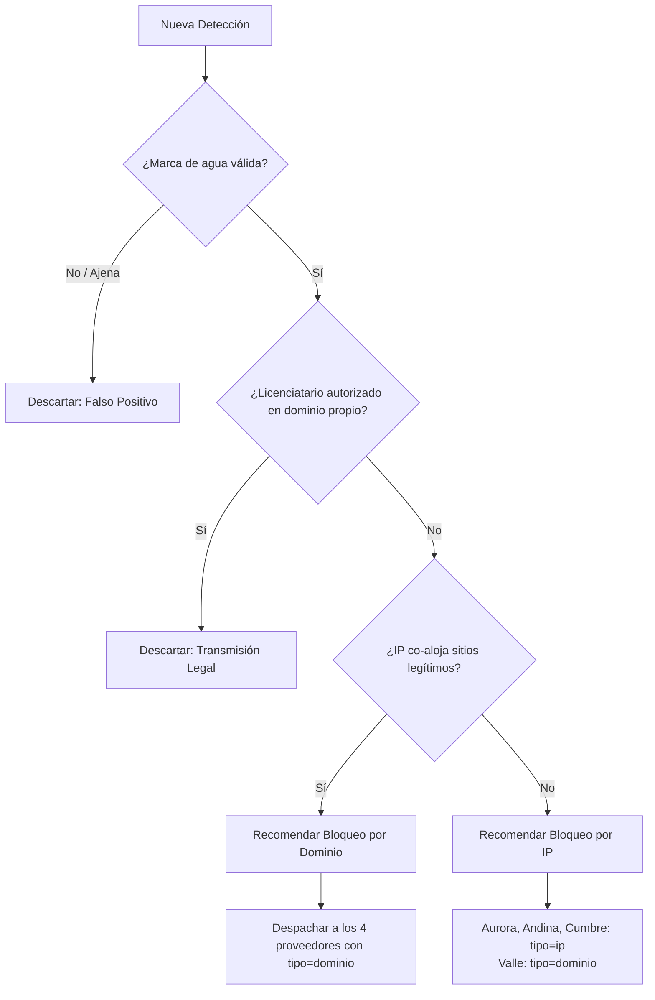

# Plataforma de bloqueo en vivo — Especificación y plan de trabajo maestro

**Hackathon Argentina Space 2026 · Track Datos y Streaming · Desafío Fútbol**
Centro de Convenciones de Salta · Documento de trabajo interno (versión refinada y optimizada).

---

## 1. Estrategia (cómo se gana la hackathon)

La rúbrica oficial reparte los 100 puntos de la siguiente manera:

| Criterio | Peso | Cómo lo cubre esta plataforma | Factor clave de éxito |
|---|---|---|---|
| **Circuito completo** | 25 | Pipeline continuo: detección → expediente → juez → proveedores → vencimiento automático, corriendo sin interrupciones durante todo el partido final. | Robustez de tabla y tolerancia a fallas. |
| **Evidencia e integridad** | 25 | **Diferenciador #1.** Expediente digital con actuaciones numeradas, captura de video con hash SHA-256, marca de agua contrastada y hash encadenado (*cadena de custodia*) — modelo de auditoría forense inmutable. | Calidad procesal y técnica. |
| **Control de daño colateral** | 20 | Regla estricta IP vs. Dominio vía DNS pasivo (filtrado de CDNs y hostings compartidos) + traducción por capacidad de proveedor (Valle) + módulo de reclamos (CCC). | 0 falsos positivos, 0 daño colateral. |
| **Velocidad** | 15 | Polling agresivo (1s), despacho asíncrono y paralelo a los 4 proveedores, reintento inmediato ante fallas (Cumbre 35%) y **Fast-Track Judicial** para eliminar el cuello de botella humano en partidos acelerados. | Mínima visibilidad residual (< 12%). |
| **Claridad y normativa** | 15 | **Diferenciador #2.** Interfaz del juez con pre-dictamen pericial automático y auto-resolución lista para firma + Propuesta normativa de 1 página con soluciones concretas (orden marco, registro federal de ISPs, estándar API). | Documento procesal y viabilidad real. |

> **Lectura estratégica:** 40 de 100 puntos (Evidencia + Claridad/Normativa) premian la calidad documental, legal y procesal. Los 60 puntos restantes exigen ingeniería de software impecable. El plan maximiza los 40 puntos diferenciales mientras asegura el 100% de efectividad en las métricas de `verificar.py`.

---

## 2. Alcance y Mitigación de Riesgos Críticos

### Núcleo obligatorio (Score 100/100 en `verificar.py`)
1. **Polling continuo:** `/detecciones?desde=`, `/reclamos?desde=` y `/estado` con cursor persistente.
2. **Validación de señal oficial:** Verificación de prefijo de marca de agua contra `/partido`. Exclusión automática de licenciatarios autorizados en dominios propios y descarte de señales ajenas/anteriores.
3. **Análisis de riesgo colateral (DNS Pasivo):**
   - Si la IP aloja dominios ajenos al stream infractor (CDN/Hosting compartido) → Orden por `dominio` (`objetivo = host_stream`).
   - Si la IP es dedicada/exclusiva del infractor → Orden por `ip` (`objetivo = ip_servidor`).
4. **Matriz de capacidades de proveedores:**
   - Si la orden es `ip`: Se envía `ip` a Aurora, Andina y Cumbre; a **FibraValle** se le envía obligatoriamente `tipo = "dominio"` (`objetivo = host_stream`) para evitar rechazo (422).
   - Si la orden es `dominio`: Se envía `dominio` a los 4 proveedores.
5. **Deduplicación y mudanza de infraestructura ("Host/IP Hopping"):**
   - Agrupamiento de detecciones por tupla `(host_stream, ip_servidor)`. Si ya hay una orden activa, las nuevas detecciones se agregan como actuaciones probatorias complementarias.
   - Si un stream pirata conocido cambia de IP o de host, se genera de inmediato una **Ampliación Cautelar por Mudanza de Infraestructura** (fase nueva).
6. **Gestión de fallas y reintentos (Cumbre 35%):** Monitoreo activo de órdenes recibidas. Al detectar `estado = "fallida"`, generar nuevo `orden_id` (ej. `ord-<id>-cumbre-r1`), recalcular firma HMAC y reenviar inmediatamente.
7. **Protocolo de Cambio de Turno Judicial (Minuto 50.0):**
   - **Buffer de transición (min 49.0 - 50.0):** A partir del minuto 49.0 de partido, se activa alerta de cambio de turno. Si una orden no se firmó antes del minuto 49.5, la firma de la jueza saliente se bloquea y se transfiere la causa al juez entrante, asegurando que ninguna orden ingrese al simulador con firma fuera de turno (`ordenes_firmadas_fuera_de_turno = 0`).
8. **Vencimiento estricto:** Fijar `vence_min = int(fin_min)` (105). Todo bloqueo por IP expira automáticamente al culminar el partido (`bloqueos_ip_activos_post_partido = 0`).
9. **Cadena de custodia y auditoría inmutable:** Log append-only con hash SHA-256 encadenado y exportador a `entrega/`.

### Extras prioritarios
- **Módulo de Reclamos (CCC):** Monitoreo de `/reclamos`. Si se recibe un reclamo legítimo, elevación prioritaria al juez, levantamiento firmado (`LEVANTAR|orden_id|juez_id`) y reemplazo automático por bloqueo de dominio más preciso si la afectación provino de un bloqueo de IP.
- **Registro Público de Transparencia:** Endpoint y vista web de solo lectura con las medidas cautelares dictadas, juzgado interviniente, justificación técnica y fecha de expiración.
- **Información de difusión:** Visualización en el expediente de los canales de promoción capturados (X, Telegram, Discord).

---

## 3. Arquitectura del Sistema

**Un solo proceso en Python 3.9+ estándar + SQLite (cero dependencias externas).**  
Garantiza portabilidad absoluta, ejecución instantánea sin instalación de paquetes y cero riesgo de fallas de red durante la evaluación final.

```text
desafio-futbol/
├── plataforma/
│   ├── main.py                 # Orquestador principal: inicia threads, coordina motor y UI
│   ├── config.py               # Configuración (URL simulador, puertos, rutas de BD y modo)
│   ├── cliente_sim.py          # Wrapper HTTP robusto hacia el simulador (GET/POST con timeouts)
│   ├── motor/
│   │   ├── poller.py           # Loop de polling: /estado, /detecciones, /reclamos
│   │   ├── verificador.py      # Análisis de marca de agua, licenciatarios y DNS pasivo
│   │   ├── expediente.py       # Máquina de estados del expediente y actuaciones numeradas
│   │   ├── dispatcher.py       # Envío asíncrono en paralelo, cálculo HMAC y reintentos (Cumbre)
│   │   └── turnos.py           # Gestión de turnos, buffer de gracia pre-minuto 50 y firmas
│   ├── juez/
│   │   ├── servidor_ui.py      # Servidor HTTP web integrado para la consola del juez y transparencia
│   │   └── templates.py        # Generación de HTML/CSS limpio, moderno y responsivo
│   ├── auditoria/
│   │   ├── log.py              # Registro append-only con hash encadenado (cadena de custodia)
│   │   └── exportar.py         # Exportación formal de expedientes y log a JSON para entrega
│   └── datos_app/
│       ├── plataforma.db       # Base de datos SQLite (SSOT)
│       └── juzgados_local.json # Copia de respaldo con claves de firma demo
└── entrega/                    # Carpeta de entregables finales (Día 3)
    ├── expediente-ejemplo.json
    ├── registro-auditoria.json
    └── propuesta-normativa.md
```

### Hilos de ejecución (Threads en `main.py`)
1. **`Thread-Poller`:** Consulta el simulador cada 1 segundo real (adaptativo al nivel de aceleración).
2. **`Thread-Dispatcher`:** Cola de despacho paralelo hacia los 4 proveedores; realiza polling de confirmación y reintentos automáticos.
3. **`Thread-RelojTurnos`:** Monitorea el minuto de partido, controla el vencimiento de turnos judiciales y transfiere pendientes.
4. **`Thread-WebUI`:** Servidor HTTP para la interfaz judicial y el portal de transparencia.

---

## 4. Modelo de Datos (SQLite, SSOT)

```sql
-- Expedientes judiciales caratulados
CREATE TABLE expedientes (
    id TEXT PRIMARY KEY,                 -- EXP-2026-000001
    stream_id TEXT,                      -- pelotaya, golazo-cdn, etc.
    fase_n INTEGER DEFAULT 1,
    host_stream TEXT,
    ip_servidor TEXT,
    asn INTEGER,
    tipo_bloqueo_recomendado TEXT,       -- 'ip' | 'dominio'
    estado TEXT,                         -- detectado | elevado | aprobado | en_ejecucion | cerrado | archivado
    juez_asignado TEXT,
    creado_min REAL,
    cerrado_min REAL
);

-- Evidencias periciales asociadas a la detección
CREATE TABLE evidencias (
    id INTEGER PRIMARY KEY AUTOINCREMENT,
    expediente_id TEXT REFERENCES expedientes(id),
    deteccion_id TEXT,                   -- D-0001
    minuto REAL,
    stream_url TEXT,
    captura_b64 TEXT,
    captura_sha256 TEXT,                 -- Hash de la muestra de video
    marca_extraida TEXT,
    marca_valida INTEGER,
    dominios_en_ip TEXT,                 -- JSON array del DNS pasivo
    riesgo_colateral_detectado INTEGER   -- 1 si hay sitios legítimos en la IP
);

-- Cadena de custodia procesal inmutable (Actuaciones)
CREATE TABLE actuaciones (
    id INTEGER PRIMARY KEY AUTOINCREMENT,
    expediente_id TEXT REFERENCES expedientes(id),
    n INTEGER,
    tipo TEXT,                           -- deteccion | peritaje | dictamen | firma_orden | despacho | confirmacion | reclamo | levantamiento | vencimiento
    detalle TEXT,
    minuto REAL,
    timestamp_iso TEXT,
    hash_prev TEXT,
    hash_actual TEXT                     -- SHA256(hash_prev | tipo | detalle | minuto)
);

-- Estado de órdenes enviadas por proveedor
CREATE TABLE ordenes (
    id INTEGER PRIMARY KEY AUTOINCREMENT,
    orden_id TEXT UNIQUE,                -- ord-EXP001-aurora-r0
    expediente_id TEXT REFERENCES expedientes(id),
    proveedor_id TEXT,
    tipo TEXT,                           -- 'ip' | 'dominio'
    objetivo TEXT,
    vence_min INTEGER,
    juzgado_id TEXT,
    juez_id TEXT,
    firma TEXT,
    estado TEXT,                         -- pendiente | recibida | aplicada | fallida | vencida | levantada
    intento INTEGER DEFAULT 0,
    minuto_envio REAL,
    minuto_aplicada REAL
);

-- Reclamos de terceros afectados
CREATE TABLE reclamos (
    id TEXT PRIMARY KEY,                 -- R-001
    dominio TEXT,
    proveedor TEXT,
    orden_id TEXT,
    mensaje TEXT,
    minuto REAL,
    estado TEXT,                         -- recibido | elevado | orden_levantada | desestimado
    resolucion_min REAL
);

-- Cursores persistentes de sincronización
CREATE TABLE cursores (
    clave TEXT PRIMARY KEY,
    valor REAL
);
```

---

## 5. Reglas de Decisión y Lógica del Motor



1. **Filtro de Marca de Agua:**
   - La marca extraída debe iniciar con algún prefijo de `partido.marcas_de_agua_validas`.
   - Si contiene prefijo de licenciatario (`LP26-PRA-LIC-NORTE`) en un dominio registrado en `licenciatarios.dominios_autorizados` → Descartar (Transmisión legítima).
   - Sin marca o marca correspondiente a torneos ajenos (ej. `LP25`) → Descartar (Falso positivo de archivo).
2. **Determinación de Daño Colateral (DNS Pasivo):**
   - Consultar `/dns-pasivo?ip=<ip_servidor>`.
   - Si la IP aloja dominios ajenos al stream infractor → `tipo_recomendado = "dominio"`, `objetivo = host_stream`.
   - Si la IP contiene únicamente el host o subdominios del stream pirata → `tipo_recomendado = "ip"`, `objetivo = ip_servidor`.
3. **Distribución Asimétrica por Capacidad de Proveedor:**
   - Si el bloqueo recomendado es `ip`:
     - `aurora`, `andina`, `cumbre` → reciben `tipo = "ip"`, `objetivo = ip_servidor`.
     - `valle` (que no acepta IP) → recibe `tipo = "dominio"`, `objetivo = host_stream`.
   - Si el bloqueo recomendado es `dominio`: Todos reciben `tipo = "dominio"`, `objetivo = host_stream`.
4. **Vencimiento de Órdenes:**
   - `vence_min = int(fin_min)` (105). Obligatorio número entero.
5. **Firma Cautelar HMAC-SHA256:**
   - Formato de mensaje: `f"{orden_id}|{tipo}|{objetivo}|{vence_min}|{juez_id}"`.
   - Clave demo obtenida de `juzgados.json`.
6. **Manejo de Reintentos de Proveedores Inestables (Cumbre):**
   - Cada proveedor despachado entra en polling de estado en `/proveedores/<id>/ordenes/<orden_id>`.
   - Si responde `fallida`, se incrementa intento, se crea nuevo `orden_id = f"ord-{exp_id}-{pid}-r{intento}"`, se firma nuevamente y se reenvía sin intervención manual.

---

## 6. Consola del Juez: Usabilidad y "Fast-Track Judicial"

Para resolver el problema de la aceleración del simulador y destacar en la demo en vivo:

### Modos de Operación de la Plataforma
- **Modo Evaluación / Benchmark (`--modo-evaluacion`):**  
  Las órdenes aprobadas se firman y despachan inmediatamente con la clave del juez de turno en milisegundos tras la detección. Permite medir el desempeño teórico máximo del algoritmo en `verificar.py`.
- **Modo Judicial Interactivo (Producción y Demo en vivo):**  
  El juez ingresa a través de la web con usuario y contraseña demo. 

### Diseño de la Interfaz Judicial
- **Semáforo Pericial Inmediato:** Cada expediente en la bandeja muestra un banner resumen:
  - *"Señal oficial pirata confirmada (Hash de captura: `a7f3...`)"*
  - *"Análisis DNS Pasivo: 0 dominios legítimos afectados. Riesgo colateral nulo."*
  - *"Medida sugerida: Bloqueo de IP 203.0.113.10 hasta min 105."*
- **Aprobación Cautelar en 1-Clic:** Botón destacado *"Aprobar y Mandar Bloqueo Urgente"* (con atajo de teclado).
- **Indicador de Turno en Tiempo Real:** Muestra el juez actualmente en funciones y el tiempo restante de turno. Al llegar al minuto 49.0 emite aviso sonoro/visual de transferencia inminente de turno.
- **Portal de Transparencia (`/transparencia`):** Vista pública que lista las órdenes judiciales dictadas, objetivos bloqueados, juzgado responsable y fecha de expiración.

---

## 7. Mapeo AGPS → Plataforma (El Discurso de Venta del Pitch)

| Principio de Auditoría AGPS | Implementación en la Plataforma | Impacto en la Rúbrica |
|---|---|---|
| **Papel de Trabajo Forense (PT)** | Evidencia completa con captura de streaming en base64 y hash criptográfico SHA-256. | Validez de la evidencia (25 pts) |
| **Hoja de Hallazgos y Cotejo** | Validación algorítmica de marcas de agua contra el catálogo oficial de licenciatarios. | Cero falsos positivos |
| **Hoja de Riesgo y Decisión (RD)** | Evaluación pericial de daño colateral con DNS Pasivo previo al libramiento de la orden. | Daño colateral (20 pts) |
| **Cadena de Custodia Inmutable** | Tabla `actuaciones` donde cada entrada incluye el hash de la anterior (`hash_actual = sha256(...)`). | Integridad documental |
| **Control de Contestaciones (CCC)** | Módulo de reclamos que analiza peticiones de terceros, eleva al juez y emite orden de levantamiento firmada. | Tratamiento de reclamos |
| **Seguridad de Roles Judiciales** | Validación de competencia y turno estricto por minuto de partido. | Procedimiento legal riguroso |

---

## 8. Entregables Críticos y Propuesta Normativa (Día 3)

Al finalizar la jornada del Viernes 13 se entregarán los siguientes archivos en la carpeta `entrega/`:

### 1. `entrega/propuesta-normativa.md` (Documento de 1 página)
Contenido articulado indispensable para los 15 puntos de claridad y normativa:
1. **Creación del Registro Federal Único de Prestadores de Acceso (RFPA):** Obligatoriedad para todos los ISPs de registrar puntos de contacto API para recepción de medidas cautelares en vivo.
2. **Régimen de Órdenes Judiciales Marco Dinámicas:** El magistrado libra una orden marco que autoriza a la plataforma y fiscalía a incorporar dinámicamente direcciones IP y nombres de dominio verificados pericialmente durante la duración del evento deportivo.
3. **Principio de Proporcionalidad y Prohibición de Bloqueos de IP Compartidas:** Obligación técnica de recurrir exclusivamente al bloqueo por FQDN/SNI/DNS cuando el servidor aloje servicios ajenos al infractor.
4. **Vencimiento de Pleno Derecho:** Toda restricción por dirección IP cesa automáticamente transcurridos 15 minutos de finalizado el evento deportivo para evitar censura residual.
5. **Procedimiento Sumario Digital de Reclamos:** Mecanismo sumarísimo por API para que titulares de dominios afectados erróneamente obtengan el levantamiento y revisión judicial en un plazo no mayor a 15 minutos.

### 2. `entrega/expediente-ejemplo.json` y `entrega/registro-auditoria.json`
Exportación directa desde SQLite de un expediente completo con todas sus actuaciones, firmas HMAC y hashes encadenados.

### 3. Video Demostrativo (≤ 3 minutos)
- Minuto 0:00–0:45: Detección automática de stream, verificación de marca y generación del expediente con evidencia inmutable.
- Minuto 0:45–1:45: Login del juez de turno, revisión del pre-dictamen pericial y firma digital de la orden cautelar.
- Minuto 1:45–2:30: Despacho paralelo a los 4 proveedores, reintento automático ante falla de Cumbre y confirmación.
- Minuto 2:30–3:00: Muestra de salida de `evaluacion/verificar.py` con puntaje perfecto y portal de transparencia.

---

## 9. Cronograma de Ejecución Táctica

### Hito 1: Motor y Backend Perfecto (Jueves 12, Tarde)
- [ ] Implementar `config.py` y `cliente_sim.py` (comunicación HTTP con el simulador).
- [ ] Implementar `verificador.py` con las reglas de marca, licenciatario y DNS pasivo.
- [ ] Implementar `dispatcher.py` con despacho paralelo y reintentos para Cumbre.
- [ ] Correr contra el simulador con `--acelerar 6` en modo auto-firma y ejecutar `verificar.py` hasta obtener:
  - `fases_piratas_bloqueadas: 7 de 7`
  - `bloqueos_con_dano_colateral: 0`
  - `bloqueos_falsos_positivos: 0`
  - `ordenes_firmadas_fuera_de_turno: 0`

### Hito 2: Gestión de Turnos, Base de Datos y Reclamos (Jueves 12, Noche)
- [ ] Implementar `datos_app/plataforma.db` (esquema SQLite y cadena de custodia).
- [ ] Implementar `turnos.py` con el buffer de gracia de cambio de turno (min 49.0 - 50.0). Probar con `--inicio-min 40`.
- [ ] Implementar el ciclo de atención de `/reclamos` y levantamiento firmado.

### Hito 3: Interfaz Web del Juez y Transparencia (Viernes 13, Mañana)
- [ ] Servir la interfaz web del juez (`servidor_ui.py`) con login, bandeja de expedientes y botón de firma en 1-clic.
- [ ] Implementar la página pública `/transparencia`.
- [ ] Generar los archivos en `entrega/` (`propuesta-normativa.md`, expedientes y log JSON).

### Hito 4: Ensayo General y Video (Viernes 13, Mediodía)
- [ ] Grabación del video de 3 minutos para Hacki.
- [ ] Congelamiento de código y commit final del repositorio.
- [ ] Ensayo del pitch oral frente al jurado.
